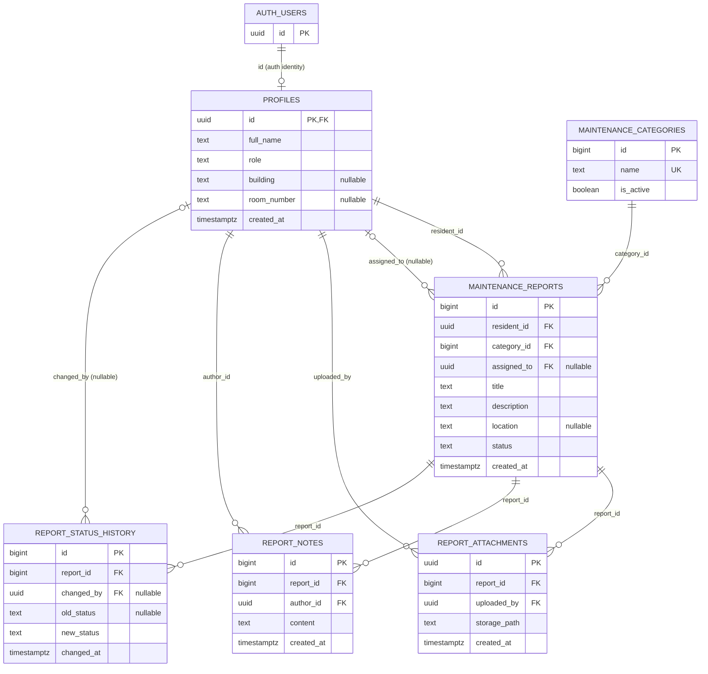

# FixMate — Entity Relationship Diagram

This diagram is based on the six actual `public` tables and the foreign-key constraints exported from Supabase on 21 November 2026. `auth.users` appears as an external, Supabase-managed authentication entity.

**How to interpret the diagram:** the central `maintenance_reports` table belongs to a resident, refers to one category and can optionally be assigned to a staff profile. Reports can have multiple attachments, internal notes and status-history entries. `profiles.id` is also a foreign key to `auth.users.id`.

The source can be edited in [FIXMATE_ERD.mmd](erd/FIXMATE_ERD.mmd). Check [Database Architecture](DATABASE_ARCHITECTURE.md) for an explanation of the exact foreign keys, column types, identities and authorization rules.
