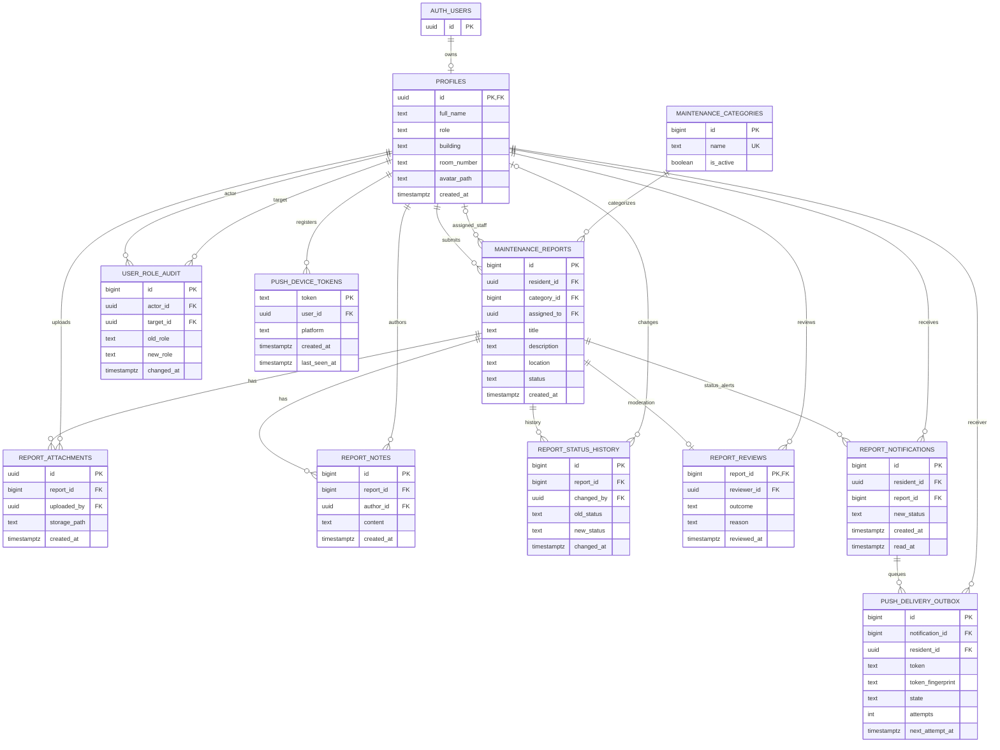

# FixMate — hosted 11-table ERD (22 November 2026)

The diagram below reflects the **11 actual application tables in
`public`** after nine additive hosted Supabase migrations. Every table
has Row Level Security (RLS) enabled. `auth.users` belongs to Supabase,
and private Storage object payloads are not held in `public` tables.
This supersedes the **historical six-table** ERD for the current hosted
academic test environment.

## Design notes

- `auth.users` has a one-to-one relationship with `profiles`;
  other `public` tables use `profiles.id` for ownership, review,
  staff and audit references.
- A report can have many attachments, notes, status-history rows,
  and notifications, but at most one immutable moderation review.
- `report_reviews` tracks Moderator decisions (`valid`, `duplicate`,
  `inappropriate`). Rejected reports cannot be assigned or moved to
  in-progress state.
- `push_delivery_outbox.notification_id` points to a stored in-app
  status notification. The delivery `token` is a snapshot string, not
  a foreign key to `push_device_tokens.token`: a database trigger
  cancels queued jobs if a token is unregistered.
- Photo bytes are stored separately in private Supabase Storage
  buckets `report-photos` and `profile-avatars`. `storage_path`
  and `avatar_path` are text metadata, not foreign keys to
  `storage.objects` in this application schema.
- `push_delivery_outbox` has RLS enabled but no client-facing policies
  or table grants. The trusted server accesses it with a privileged
  credential; it is not exposed to Residents or Staff.
- The 11 application tables do **not** count the Supabase-managed
  `auth.users` table or Storage internal tables.
